  

 

 

I'm a full-stack developer with a BSc (Hons) in Creative Computing from Bath Spa University (Ras Al Khaimah), graduating with First-Class Honours and a 3.8/4.0 GPA. I build responsive web apps with REST APIs, secure authentication (JWT, OAuth 2.0) and payment integration, and I've recently been working on applied machine learning, AI agents and data pipelines.

**Experience**

- **Software & ML/AI Intern** (Remote, 07/2026 to 10/2026): delivered 3 end-to-end projects across data pipelines, AI agents and applied machine learning, with QA test suites, evaluation reports and setup documentation.
- **Marketing & Brand Design Intern**, Prime Marketing UAE (01/2025 to 06/2025): built brand identity and marketing assets, including the Prime Arcade campaign. My content strategy lifted customer inquiries by 40%.
- **Glowing e-commerce project** (2024): full-stack platform with cart, order processing and PayPal Sandbox payments.

 

 

<b>All certificates</b>

 

**LinkedIn Learning**
Advanced Python · Building RESTful APIs with Node.js and Express · Creating a Responsive Web Design · Cybersecurity Foundations · Cybersecurity Foundations: Computer Forensics · Ethical Hacking: Session Hijacking · HTML, CSS, and JavaScript: Building the Web · Introduction to Web APIs · Learning Arduino: Foundations · Learning Cyber Incident Response and Digital Forensics · Learning TypeScript · Machine Learning with Python: Foundations · Prompt Engineering: How to Talk to the AIs · Python for Data Visualization · Responsive Layout · Shopify Ecommerce: Marketing Strategy

**SoloLearn**
Introduction to HTML · Introduction to CSS · Introduction to Java · Python Intermediate · Introduction to Python

**Great Learning Academy**
Python Tkinter

**Events and industry**
GDGoC Bath Spa University UAE: "Build Intelligent Agents" workshop (26 Nov 2025) · GDGoC Bath Spa University UAE: "Mission: Digital Escape" event participation · Prime Marketing: Certificate of Appreciation

 

 

  
  
  
  
  
  
  

<!-- TODO: wrap the Glowing, Ascend and BookVerse cards in <a href="..."> once the live demo or GitHub links are confirmed. -->

<b>Project details as text</b>

 

- **Glowing**: premium skincare e-commerce platform with cart, order processing, PayPal Sandbox checkout and a Chart.js sales dashboard, using JWT and Google OAuth 2.0. Deployed on Vercel.
- **Ascend**: SaaS landing page with an interactive real-time 3D Earth and a user dashboard. Firebase Authentication with Google, GitHub and email sign-in.
- **BookVerse**: responsive online bookstore with bcrypt-secured authentication, theme switching and search (Node.js, Express, MongoDB Atlas).
- [**Multi-Tool AI Agent**](https://github.com/MohdRashid1607/Ai-agent-assignment): Python agent that routes between weather and currency tools using Google Gemini, with an allow-list execution checkpoint, request tracing, 16 pytest tests, a Flask endpoint and a Dockerfile.
- [**Lottery Data Pipeline**](https://github.com/MohdRashid1607/ld-ml-02-lottery-pipeline): scrapers with bounded retries and rate limiting, YAML-driven validation, normalized SQLite storage, Open-Meteo weather enrichment and a Streamlit explorer.
- [**Machine Failure Risk Monitor**](https://github.com/MohdRashid1607/ld-ml-03-machine-failure-risk): unsupervised anomaly detection comparing an Isolation Forest against a Robust Z-Score baseline, deployed as a Gradio app on Hugging Face.
- [**SkillBridge**](https://skillbridge-io.netlify.app): student skill marketplace built by a 7-person team. I was the Marketing Manager (content strategy, brand campaign, YouTube channel).

 

 

<b>Skills as text</b>

 

**Languages:** JavaScript (ES6+), TypeScript, Python, SQL, HTML5, CSS3, Java (introductory), C# (Unity)
**Frontend:** Responsive design, Tailwind CSS, Chart.js, p5.js, Processing
**Backend and auth:** Node.js, Express.js, REST APIs, JWT, OAuth 2.0, Passport.js, Firebase Authentication, bcrypt, Flask
**Databases:** MongoDB, MongoDB Atlas, MySQL, SQLite
**AI and data:** Machine learning, scikit-learn, AI agents, prompt engineering, Gradio, Streamlit, Hugging Face, Google Dialogflow, MediaPipe
**Tools and design:** Git, GitHub, Postman, VS Code, Docker, pytest, Vercel, Cloudinary, Figma, Canva, Arduino

 

 

  
   
  Live data from my GitHub contribution graph.

 

  

 

 

  
  
  

 

  

