  

   

  <a href="#about">About</a> &nbsp;·&nbsp; <a href="#projects">Projects</a> &nbsp;·&nbsp; <a href="#skills">Skills</a> &nbsp;·&nbsp; <a href="#achievements">Achievements</a> &nbsp;·&nbsp; <a href="#contact">Contact</a>

 

## About

I'm a full-stack developer with a BSc (Hons) in Creative Computing from Bath Spa University (Ras Al Khaimah), graduating with First-Class Honours. I build responsive web apps with REST APIs, secure authentication (JWT, OAuth 2.0) and payment integration, and I've recently been working on applied machine learning, AI agents and data pipelines.

**I'm open to full-time, on-site Full-Stack Developer roles.**

- **Software & ML/AI Intern** (Remote, 07/2026 to 10/2026): delivered 3 end-to-end projects across data pipelines, AI agents and applied machine learning, with QA test suites and evaluation reports.
- **Marketing & Brand Design Intern**, Prime Marketing UAE (01/2025 to 06/2025): built brand identity and the Prime Arcade campaign, and my content strategy lifted customer inquiries by 40%.
- **Glowing e-commerce project** (2024): full-stack platform with cart, order processing and PayPal Sandbox payments.

 

## Projects

  
  
  
  
  
  
  

<!-- TODO: wrap the BookVerse card in <a href="..."> once its repo or live link is confirmed. -->

 

## Skills

- **Languages:** JavaScript (ES6+), TypeScript, Python, SQL, HTML5, CSS3, Java (introductory), C# (Unity)
- **Frontend:** Responsive design, Tailwind CSS, Chart.js, p5.js, Processing
- **Backend and auth:** Node.js, Express.js, REST APIs, JWT, OAuth 2.0, Passport.js, Firebase Authentication, bcrypt, Flask
- **Databases:** MongoDB, MongoDB Atlas, MySQL, SQLite
- **AI and data:** Machine learning, scikit-learn, AI agents, prompt engineering, Gradio, Streamlit, Hugging Face, Google Dialogflow, MediaPipe
- **Tools and design:** Git, GitHub, Postman, VS Code, Docker, pytest, Vercel, Cloudinary, Figma, Canva, Arduino

 

## Achievements

- **First-Class Honours**, BSc (Hons) Creative Computing, GPA 3.8/4.0
- **Certificate of Appreciation** from Prime Marketing for the Prime Arcade campaign, signed by the company CEO
- **Ethical Hacking: Session Hijacking**, CompTIA-endorsed, CEU 1.00 (LinkedIn Learning)
- **One Million Prompters Initiative**, launched by H.H. Sheikh Hamdan bin Mohammed, Crown Prince of Dubai
- **Student Ambassador Award** and **Academic Excellence Award**
- **Build Intelligent Agents workshop**, GDGoC Bath Spa University UAE (Google Agent Development Kit, Nov 2025)

Off the keyboard: medals in the 800m race (gold, silver and bronze), silver in a basketball tournament, silver in a cricket tournament, and an Ajman government marathon medal.

<b>All certificates</b>

 

**LinkedIn Learning**

Advanced Python · Building RESTful APIs with Node.js and Express · Creating a Responsive Web Design · Cybersecurity Foundations · Cybersecurity Foundations: Computer Forensics · Ethical Hacking: Session Hijacking · HTML, CSS, and JavaScript: Building the Web · Introduction to Web APIs · Learning Arduino: Foundations · Learning Cyber Incident Response and Digital Forensics · Learning TypeScript · Machine Learning with Python: Foundations · Prompt Engineering: How to Talk to the AIs · Python for Data Visualization · Responsive Layout · Shopify Ecommerce: Marketing Strategy

**SoloLearn**

Introduction to HTML · Introduction to CSS · Introduction to Java · Python Intermediate · Introduction to Python

**Great Learning Academy**

Python Tkinter

**Events and industry**

GDGoC Bath Spa University UAE: "Build Intelligent Agents" workshop (26 Nov 2025) · GDGoC Bath Spa University UAE: "Mission: Digital Escape" event participation · Prime Marketing: Certificate of Appreciation

 

## Contributions

  <picture>
    <source media="(prefers-color-scheme: dark)" srcset="https://raw.githubusercontent.com/MohdRashid1607/MohdRashid1607/output/github-contribution-grid-snake-dark.svg">
    <source media="(prefers-color-scheme: light)" srcset="https://raw.githubusercontent.com/MohdRashid1607/MohdRashid1607/output/github-contribution-grid-snake.svg">
    
  </picture>

 

## Contact

  
  
  

    

  

